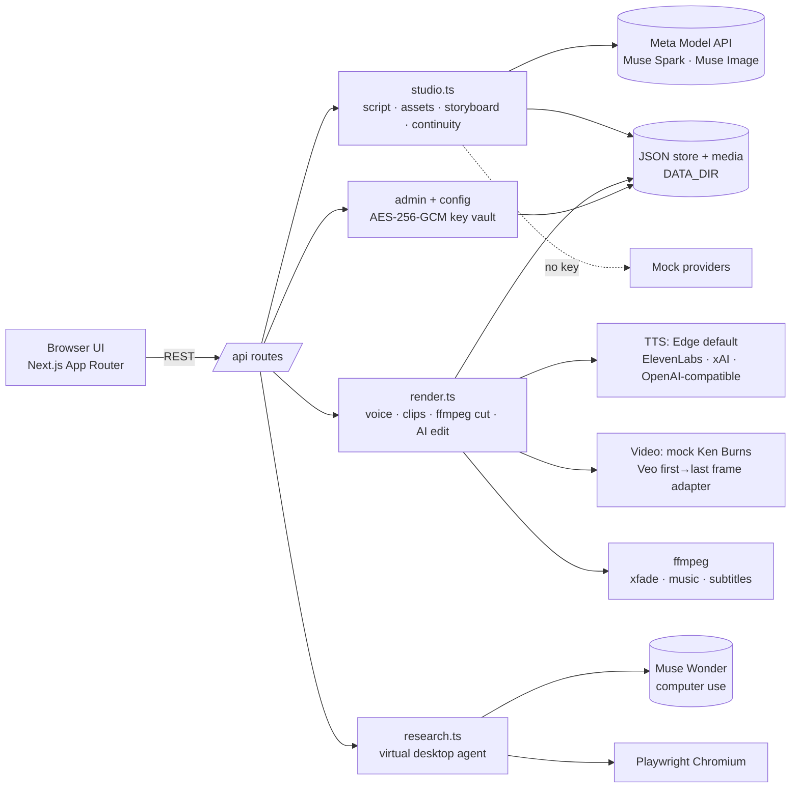

# Opie AI Movie Studio

**Meta Global AI Developer Hackathon — Indie track.**
Opie is a Flow‑style AI film studio for solo creators: turn an idea, brainstorm or script into a finished **drama, documentary or product ad** for YouTube Shorts, TikTok, Facebook Reels or long‑form YouTube — with consistent characters, a continuity checker, voices, music, subtitles and an AI editor.


| Mobile (390px) | Tablet (768px) |
|---|---|
|  |  |

## How Opie uses Meta AI

| Meta model | Where it is used |
|---|---|
| **Muse Spark** (`/chat/completions`, JSON mode) | Brainstorm chat, screenplay writing, asset extraction (cast/locations/props), "story bible", shot breakdown, prompt rewrites, **continuity checks**, cut review, AI editor command parsing |
| **Muse Image** (`/images/generations`, `/images/edits`) | Character / location / prop reference sheets, storyboard **start & end frames** — each frame is generated from the asset references *and* the previous frame, so faces, wardrobe and props stay consistent; one‑click continuity fixes re‑edit the frame |
| **Muse Wonder** (Responses API, `computer` tool) | The **Research desktop**: an agent drives a real headless Chromium (Playwright), browses YouTube for trending formats in your niche and writes notes you can inject into a project's brief |

Every Meta call goes through one server-side adapter (`src/lib/providers/meta.ts`). Keys are never sent to the browser.

## Architecture



## Features

- **Modes:** drama · documentary · product ad. **Formats:** Shorts, TikTok, Reels, YouTube long. **Aspect:** 9:16, 16:9, 1:1, 4:5. **Styles:** realistic, Pixar/3D, cartoon, anime, custom.
- **Output:** *Image mode* (animated stills with Ken Burns + crossfades) or *Video mode* (first→last‑frame clips per shot).
- **Tabs like Google Flow:** Script (brainstorm chat + screenplay editor + import) → Assets (upload or AI‑generate references) → Storyboard (scenes, start/end frames, prompt edits with history) → Video (voices, clips) → Edit & Export (timeline trim/reorder, music bed, burned‑in subtitles, Muse review, AI editor prompt, MP4 export).
- **Continuity checker** with per‑shot flags and **one‑click fix**.
- **Voices:** Edge TTS free by default (many voices), pluggable ElevenLabs / xAI / OpenAI‑compatible.
- **Research desktop:** watch the agent's live screenshots and steps; notes → project.
- **Admin panel** (`/admin`): login from env, add/rotate API keys and providers. Keys are encrypted at rest (AES‑256‑GCM with `APP_SECRET`), masked in the UI and never returned to the client.
- Responsive dark UI (mobile → desktop), Docker deployable.

## Mock vs live

| Capability | No keys (demo mode) | With keys (set in `/admin` or `.env`) |
|---|---|---|
| Script / assets / continuity / AI edit | Deterministic templates & heuristics | Muse Spark |
| Images & frames | ffmpeg‑generated placeholder art | Muse Image (generations + edits with refs) |
| Research | Scripted Playwright browsing of YouTube | Muse Wonder computer‑use loop (+ YouTube Data API trending if key) |
| Voices | **Edge TTS (real)** | ElevenLabs / xAI / OpenAI‑compatible |
| Video clips | Ken Burns motion from frames (real MP4) | Veo first→last frame (`GEMINI_API_KEY`, `VIDEO_PROVIDER=veo`) — adapter included, not verified live |
| Final render | **Real ffmpeg MP4** with music + subtitles | same |

## Run it

```bash
cp .env.example .env      # set APP_SECRET, ADMIN_EMAIL, ADMIN_PASSWORD
npm install
npm run dev               # http://localhost:3000
```
Requires `ffmpeg` on PATH. For the research desktop: `npx playwright install chromium` (or set `CHROMIUM_PATH`).

**Docker:**
```bash
cp .env.example .env && docker compose up --build   # http://localhost:3000, data in volume opie-data
```

Then open `/admin`, sign in, paste your Meta API key, and switch providers.

## Built during the hackathon

Everything in this repository was written for the hackathon: the Next.js app and responsive Flow‑style UI, Meta Muse adapters, the screenplay → assets → storyboard → video pipeline, chained‑reference frame generation, the continuity checker/fixer, Edge TTS and pluggable voice slots, the ffmpeg renderer and AI editor, the Playwright + Muse Wonder research desktop, and the encrypted admin key vault.

## Security

- `.env` and `data/` are git‑ignored; only `.env.example` is committed.
- Admin password from env (plain or bcrypt hash), rate‑limited login, signed httpOnly session cookie.
- API keys are stored encrypted server‑side and are shown masked only (`AIza••••7890`).

## License
MIT
