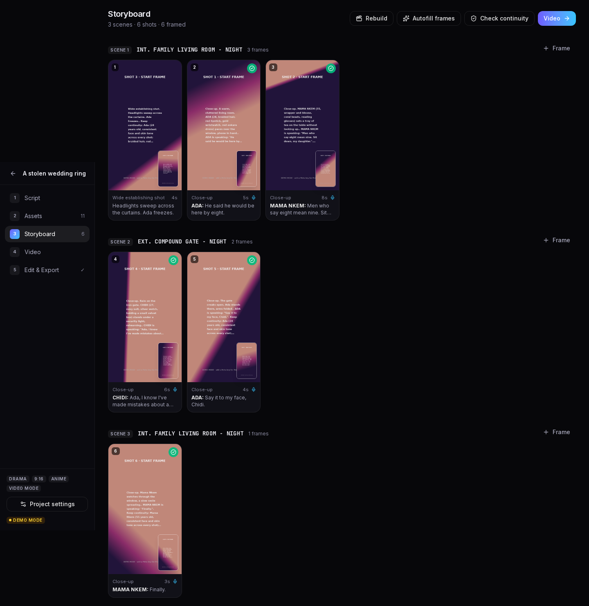
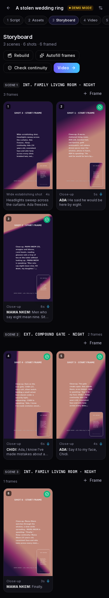
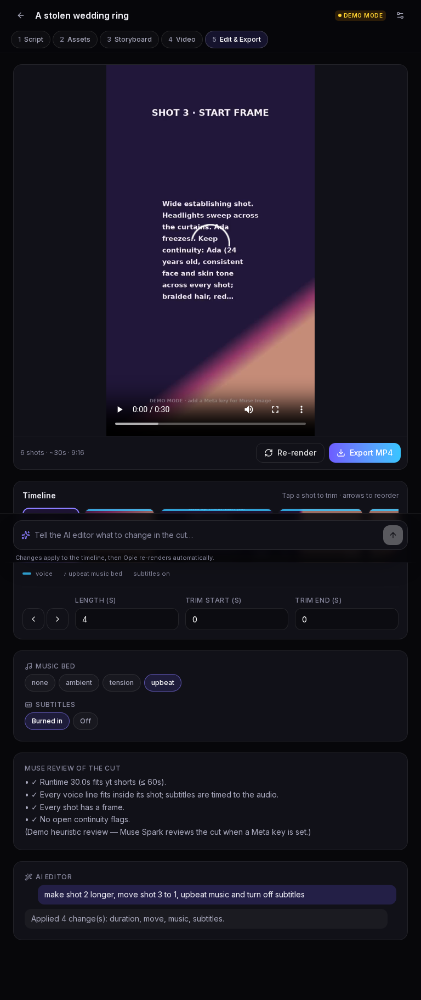
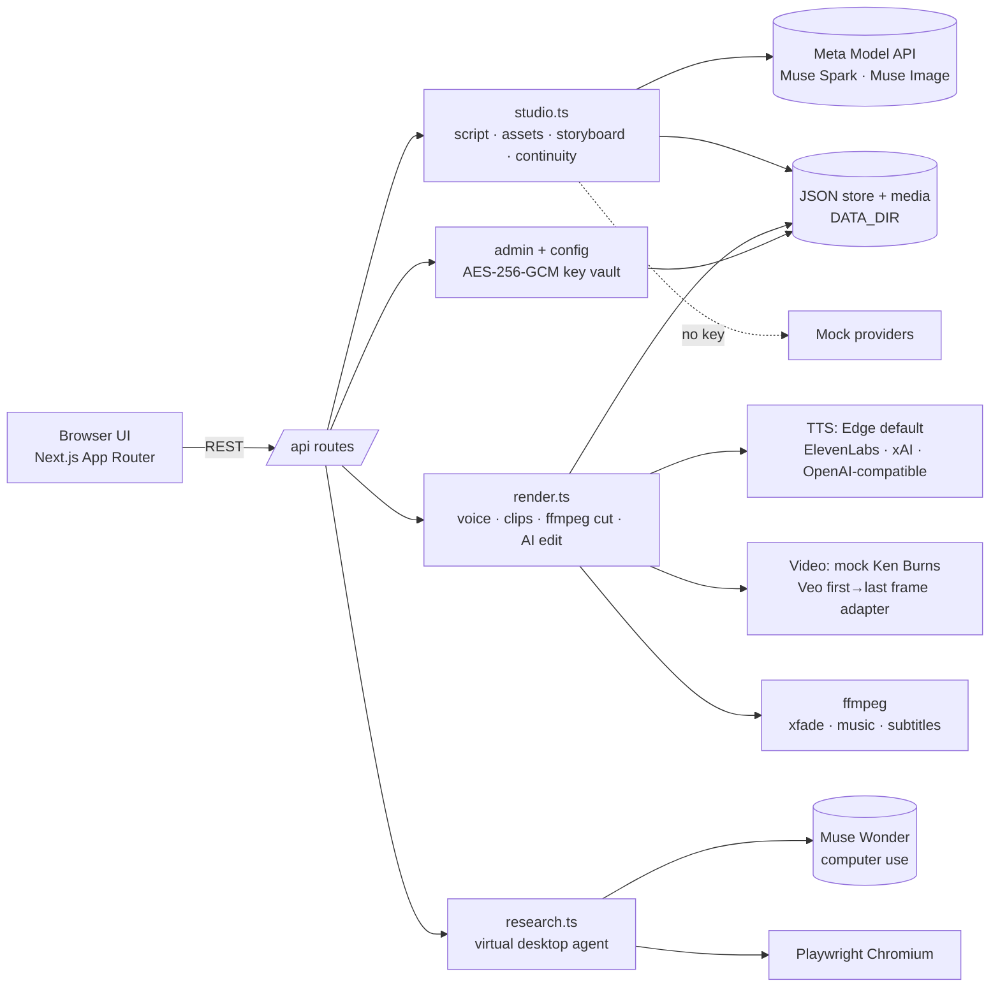

# Opie AI Movie Studio

**Meta Global AI Developer Hackathon — Indie track.**
Opie is a Flow‑style AI film studio for solo creators: turn an idea, brainstorm or script into a finished **drama, documentary or product ad** for YouTube Shorts, TikTok, Facebook Reels or long‑form YouTube — with consistent characters, a continuity checker, voices, music, subtitles and an AI editor.



| Mobile (390px) | Tablet (768px) |
|---|---|
|  |  |

## How Opie uses Meta AI

| Meta model | Where it is used |
|---|---|
| **Muse Spark** (`/chat/completions`, JSON mode) | Brainstorm chat, screenplay writing, asset extraction (cast/locations/props), "story bible", shot breakdown, prompt rewrites, **continuity checks**, cut review, AI editor command parsing |
| **Muse Image** (`/images/generations`, `/images/edits`) | Character / location / prop reference sheets, storyboard **start & end frames** — each frame is generated from the asset references *and* the previous frame, so faces, wardrobe and props stay consistent; one‑click continuity fixes re‑edit the frame |
| **Muse Wonder** (Responses API, `computer` tool) | The **Research desktop**: an agent drives a real headless Chromium (Playwright), browses YouTube for trending formats in your niche and writes notes you can inject into a project's brief |

Every Meta call goes through one server-side adapter (`src/lib/providers/meta.ts`). Keys are never sent to the browser.

## Architecture



## Features

- **Modes:** drama · documentary · product ad. **Formats:** Shorts, TikTok, Reels, YouTube long. **Aspect:** 9:16, 16:9, 1:1, 4:5. **Styles:** realistic, Pixar/3D, cartoon, anime, custom.
- **Output:** *Image mode* (animated stills with Ken Burns + crossfades) or *Video mode* (first→last‑frame clips per shot).
- **Tabs like Google Flow:** Script (brainstorm chat + screenplay editor + import) → Assets (upload or AI‑generate references) → Storyboard (scenes, start/end frames, prompt edits with history) → Video (voices, clips) → Edit & Export (timeline trim/reorder, music bed, burned‑in subtitles, Muse review, AI editor prompt, MP4 export).
- **Continuity checker** with per‑shot flags and **one‑click fix**.
- **Voices:** Edge TTS free by default (many voices), pluggable ElevenLabs / xAI / OpenAI‑compatible.
- **Research desktop:** watch the agent's live screenshots and steps; notes → project.
- **Admin panel** (`/admin`): login from env, add/rotate API keys and providers. Keys are encrypted at rest (AES‑256‑GCM with `APP_SECRET`), masked in the UI and never returned to the client.
- Responsive dark UI (mobile → desktop), Docker deployable.

## Mock vs live

| Capability | No keys (demo mode) | With keys (set in `/admin` or `.env`) |
|---|---|---|
| Script / assets / continuity / AI edit | Deterministic templates & heuristics | Muse Spark |
| Images & frames | ffmpeg‑generated placeholder art | Muse Image (generations + edits with refs) |
| Research | Scripted Playwright browsing of YouTube | Muse Wonder computer‑use loop (+ YouTube Data API trending if key) |
| Voices | **Edge TTS (real)** | ElevenLabs / xAI / OpenAI‑compatible |
| Video clips | Ken Burns motion from frames (real MP4) | Veo first→last frame (`GEMINI_API_KEY`, `VIDEO_PROVIDER=veo`) — adapter included, not verified live |
| Final render | **Real ffmpeg MP4** with music + subtitles | same |

## Run it

```bash
cp .env.example .env      # set APP_SECRET, ADMIN_EMAIL, ADMIN_PASSWORD
npm install
npm run dev               # http://localhost:3000
```
Requires `ffmpeg` on PATH. For the research desktop: `npx playwright install chromium` (or set `CHROMIUM_PATH`).

**Docker:**
```bash
cp .env.example .env && docker compose up --build   # http://localhost:3000, data in volume opie-data
```

Then open `/admin`, sign in, paste your Meta API key, and switch providers.

## Built during the hackathon

Everything in this repository was written for the hackathon: the Next.js app and responsive Flow‑style UI, Meta Muse adapters, the screenplay → assets → storyboard → video pipeline, chained‑reference frame generation, the continuity checker/fixer, Edge TTS and pluggable voice slots, the ffmpeg renderer and AI editor, the Playwright + Muse Wonder research desktop, and the encrypted admin key vault.

## Security

- `.env` and `data/` are git‑ignored; only `.env.example` is committed.
- Admin password from env (plain or bcrypt hash), rate‑limited login, signed httpOnly session cookie.
- API keys are stored encrypted server‑side and are shown masked only (`AIza••••7890`).

## License
MIT

## v2 upgrade: AI brain, Brainstorm studio, virtual desktop agent

### AI brain (provider chain)
Set these in **Admin → AI brain**. Keys are encrypted and stay on the server.
- **Meta Llama** (muse-spark / muse-wonder) is the primary whenever a Meta key exists.
- **OpenAI-compatible fallback**: `FALLBACK_BASE_URL`, `FALLBACK_API_KEY`, `FALLBACK_MODEL`, `FALLBACK_VISION_MODEL`.
  - xAI Grok is the default (`https://api.x.ai/v1`, or `XAI_API_KEY` in `.env`).
  - Any OpenAI-compatible server also works, including a local llama.cpp, e.g. `llama-server -m qwen2.5-vl.gguf --mmproj mmproj.gguf --port 8080`, then `FALLBACK_BASE_URL=http://127.0.0.1:8080/v1`.
- `LLM_PRIMARY` = auto | meta | fallback. The UI shows which provider answered.
- `LLM_TIMEOUT_MS` sets the timeout (default 240000).

### Brainstorm studio (Script tab)
- Streaming chat (NDJSON) with prompts for each mode: drama, documentary and ad.
- Replies include idea cards: logline, hook, beat sheet and characters.
- **Use this idea** sets the project idea. **Write full script** hands the idea to the Script tab.
- Research notes are attached as context chips.
- History is saved per project.

### Virtual desktop (/research)
A real agent loop runs in headless Chromium. At each step a vision LLM receives a screenshot plus the page's accessibility text and picks an action: navigate, click, type, scroll, read, transcript, frames, note or done.

The UI shows:
- the live screen and action log;
- Pause/Resume/Stop controls;
- a step cap (3–40).

Tasks:
- **Trending in a niche**: uses the YouTube Data API when `YOUTUBE_API_KEY` is set, and scrapes search results otherwise.
- **Titles and thumbnails analysis**.
- **Watch a video**: reads the captions and samples frames, then describes them with vision. It uses the youtube-nocookie embed, which works even on IPs where YouTube watch pages show a bot-check.

Notes are saved to the project automatically and feed into Brainstorm. Without an LLM key, a scripted demo runs instead.

### Opie assistant (an agent that works across the whole studio)
A floating ✨ button appears on every page, and the Virtual Desktop has a chat panel beside the live browser. You talk to it naturally. It streams a reply, plans the work, and runs studio tools one at a time, showing a progress card for each:

`create_project` (mode, format, aspect, style) · `brainstorm` · `use_idea` · `write_script` · `extract_assets` · `generate_asset_images` · `build_storyboard` · `generate_frames` · `edit_shot` · `continuity_check` / `fix_continuity` · `voiceover` · `render_video` · `edit_video` · `research` (the virtual desktop agent; notes are saved to the project) · `project_status`.

- **Example:** "make a 60s TikTok product ad for my akara brand" creates the project, then writes the script, builds the assets, storyboard and frames, renders, and finishes with a conversational summary.
- **Interrupt any time.** A message sent mid-task steers the desktop agent, and the planner re-plans around it. "stop" halts everything.
- **Follow-ups:** ask about what it saw; the tool results stay in the conversation context.
- **Weaker models:** when a model under-plans, a sequential production pipeline fills in the missing stages and never skips past a failed stage.
- **Model:** Meta Muse Wonder (`META_AGENT_MODEL`) is used when a Meta key is set. Otherwise the fallback LLM is used.
- **API:** `POST /api/agent {convId?, message, projectId?}` streams NDJSON events: `delta`, `plan`, `tool_start`, `tool_args`, `tool_end`, `status`, `session`, `project`, `turn_end`, `done`.

## Take control & persistent browser logins
- In the Research desktop, **Take control** turns the live view interactive: click, scroll, type, keys, paste, and an address bar with back/forward/reload. On mobile, use the "Type into the page" box. **Hand back to agent** sends what you did to the agent as context.
- Browser state lives in a persistent Chromium profile at `data/browser-profiles/<BROWSER_PROFILE|default>`. This folder is git-ignored. Quick links open Drive, YouTube and Gmail.
- When the agent reaches a sign-in page or a password field, it pauses and asks you to take control. It never types credentials, and typed text is never logged.
- Google may refuse sign-in in automated or headless browsers. To work around this, run the server under Xvfb with `BROWSER_HEADFUL=1` and `CHROMIUM_HEADFUL_PATH=/path/to/chrome`. The browser uses a realistic user agent and drops `--enable-automation`.

## YouTube keywords & scripts (chat only)
There is no UI for this. Ask the assistant or the desktop agent in chat, for example "extract keywords for <link or topic>" or "get the script of <link>".
- `extract_keywords` collects video tags, title and description keywords, hashtags and YouTube autocomplete suggestions. The LLM then ranks and clusters them into primary, long-tail, trending and hashtags.
- `get_youtube_script` returns the full timestamped transcript plus a hook/beats/CTA analysis.
  - Transcript sources, in order: caption tracks, the embedded player's own timedtext call (this works when watch pages are bot-gated), then rule-based analysis if the LLM fails.
  - With `use_as_script: true` it writes an ORIGINAL rewritten script into the open project. It never copies the reference.
